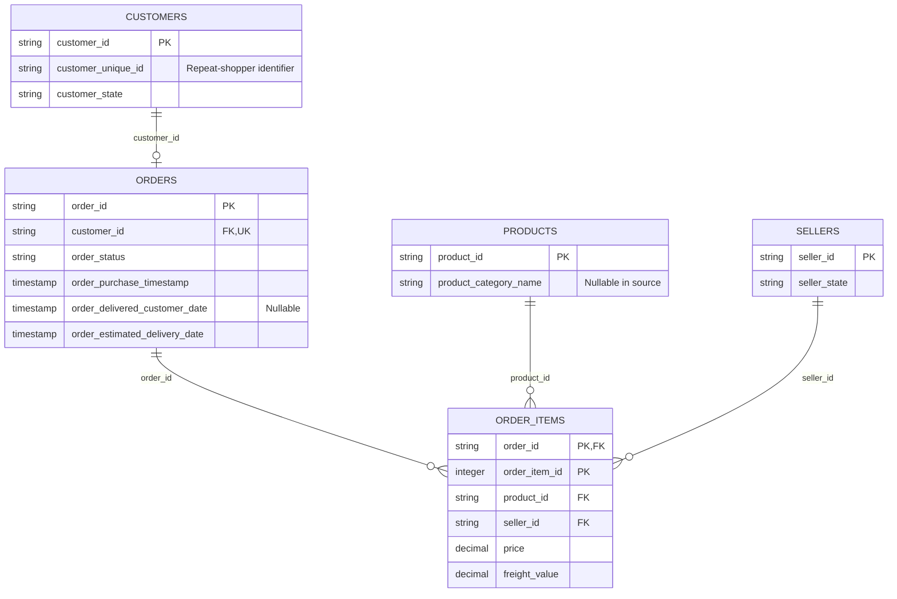

# Olist project architecture

## Scope and assumptions

Olist is an anonymized historical marketplace snapshot. The initial scope covers customers, orders, order items, products, and sellers. Payments, reviews, and geolocation are deferred. Profile coverage before choosing one complete starter quarter. Expand to all usable months once validation passes. Explore time trends, categories, sellers, geography, delivery, and customer behavior before selecting two or three defensible findings for one report.

Each replay batch selects orders by purchase month and includes the related rows needed to load them. Delivery outcomes reflect the published snapshot and may occur after the batch month. This is a historical batch simulation. The source snapshot does not provide a change stream or point-in-time operational state.

## Ingestion and relational storage

Provide a documented Python CLI with an explicit purchase-month argument, external connection configuration, meaningful exit codes, and batch logs. The same command can be run manually or scheduled later. Validate headers, parsing, key uniqueness, and references before loading. Log batch identity, per-layer outcomes, row counts, and validation failures.

PostgreSQL stores five related entities with primary and foreign keys. Use the source order and line identifiers together as the candidate order-item key. Preserve both customer identifiers. The order-linked customer ID supports joins and the repeat-customer ID supports customer-level analysis. Final keys, types, nullability, and checks are subject to source profiling and review.

Load parent records first and upsert by stable business keys inside a PostgreSQL transaction. Replaying identical input must preserve row counts and analytical values. Replaying a controlled correction under the same key must update the affected record and propagate downstream. A batch ID alone must not suppress a corrected replay. Record progress by layer so a warehouse failure can be retried safely after PostgreSQL commits. The MVP upserts supplied rows and does not infer deletions from missing rows.

## Proposed PostgreSQL ERD

The ERD shows selected columns. Join orders to customers on `customer_id`. Use `customer_unique_id` to group repeat purchases. The two fields marked PK on order items form a single composite primary key.

## Source profiling and schema review

Profiled the five core CSVs from the [published Olist snapshot](https://www.kaggle.com/datasets/olistbr/brazilian-ecommerce). The archive SHA-256 was `967e41e04fc306fe604e2a693f488995a8b41e5047418f8a5c8e4abd6deca784`.

| Source | Rows |
|---|---:|
| Customers | 99,441 |
| Orders | 99,441 |
| Order items | 112,650 |
| Products | 32,951 |
| Sellers | 3,095 |

| Finding | Design implication |
|---|---|
| All five candidate primary keys were populated and unique. All four foreign-key checks returned zero orphans. Orders had unique `customer_id` values, and 99,441 customer records represented 96,096 distinct `customer_unique_id` values. | Enforce the tested relationships and preserve both customer identifiers. |
| 775 orders had no items, 88,863 had one item, and 9,803 had multiple items. Of the multi-item orders, 1,278 had multiple sellers. | Retain every order in the order fact. Count orders at order grain and sum item amounts at item grain. |
| Eight delivered orders lacked an actual delivery timestamp. Carrier handoff preceded purchase for 166 orders, and customer delivery preceded carrier handoff for 23 orders. | Keep optional timestamps nullable, preserve the recorded values, and apply quality flags and eligibility rules to duration metrics. |
| 610 products lacked a category, and two products had missing weight or dimensions. | Allow nullable attributes in the relational model and report missing categories as Unknown in the warehouse. |
| All item prices were positive. Freight was zero for 383 items and was never negative. | Allow zero freight. Use “zero recorded freight” as the reporting label. The source does not establish why the value was zero or whether the whole order had zero freight. |

Purchases span 4 September 2016 to 17 October 2018. Monthly volumes are substantial from January 2017 through August 2018. September and October 2018 contain only 16 and 4 orders, respectively. Use January–March 2018 as the proposed starter quarter. It contains 7,269, 6,728, and 7,211 orders across three replay batches. Flag sparse edge months when comparing trends.

## Warehouse and metrics

Stage the PostgreSQL extract in Snowflake. Use SQL to merge staged rows by their business keys and build dimensions and facts. Verify warehouse key uniqueness and relationships with data-quality queries.

| Fact | Grain | Measures and dimensions |
|---|---|---|
| `fact_order` | One row per order | Order counts, status, delivery dates and eligibility, purchase date, customer geography |
| `fact_order_item` | One row per order item | Item price and freight, purchase date, customer geography, product, seller |

Expose an order-performance mart and an item-sales mart at their respective grains. Calculate order counts and delivery rates from the order mart. Sum merchandise value from eligible item rows and define freight separately. For cross-grain queries, aggregate items to one row per order before joining to orders, or use an existence filter when selecting orders that contain matching items. An order can contain several sellers or categories, so order counts by seller or category can overlap. Power BI uses shared dimensions for common filters and avoids a direct fact-to-fact relationship. Reconcile key metrics against warehouse SQL and trace a representative result back to source records.

## Verification and milestones

- **20–21 November**. Document the design, check environment and access, and profile source coverage, keys, joins, statuses, dates, and monetary fields. Review results before finalizing table definitions.
- **22–23 November**. After schema review, run one small historical batch through Python, PostgreSQL, Snowflake, and Power BI.
- **24–25 November**. Finish facts and marts. Run the starter quarter, verify identical replay and corrected-record replay, and test recovery from a warehouse failure after PostgreSQL commits. Extend coverage if checks pass.
- **26 November**. Explore the available history and validate the strongest findings and metric definitions.
- **27 November**. Polish the report, document reproduction steps, and capture an example of verification of AI-assisted work.
- **28 November**. Run final acceptance checks and use remaining time as a buffer. Add basic CI only after the core works. Scheduling and orchestration are optional.

If time is tight, retain the starter quarter, both fact grains, both replay checks, and one verified report finding.
