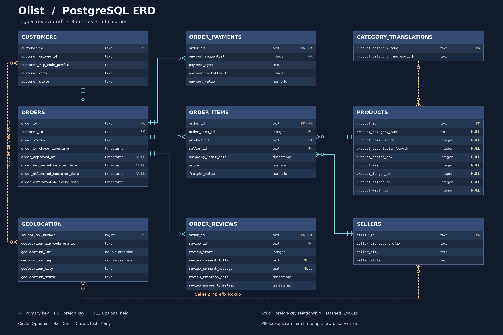
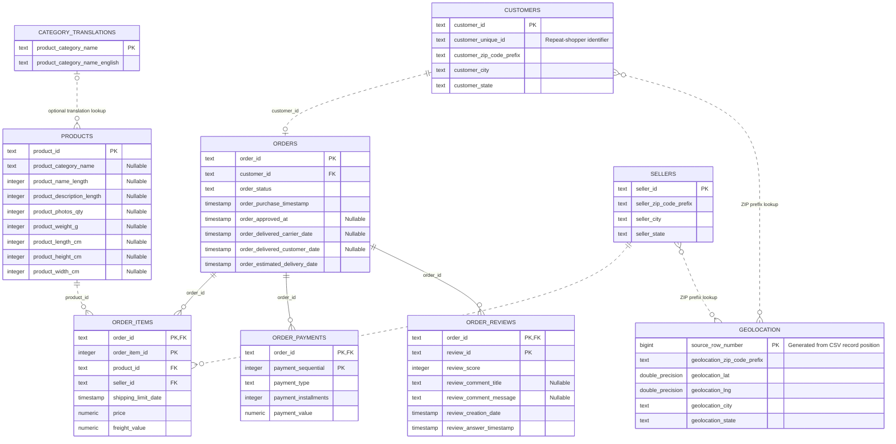
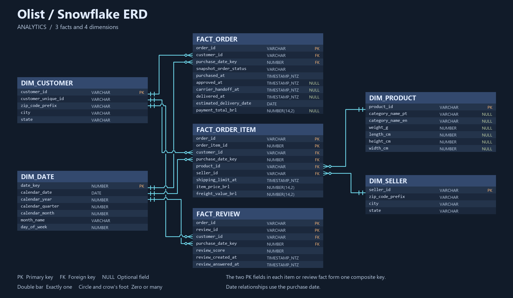

# Olist project architecture

## Scope and assumptions

Olist is an anonymized historical marketplace snapshot. The full build covers all published months and all nine files: customers, orders, order items, products, sellers, payments, reviews, geolocation, and product category translations. Profile every source before finalizing its grain, keys, and relationships. Explore the data before choosing findings for Power BI.

Each replay batch selects orders by purchase month and includes the related rows needed to load them. Delivery outcomes reflect the published snapshot and may occur after the batch month. This is a historical batch simulation. The source snapshot does not provide a change stream or point-in-time operational state.

## Ingestion and relational storage

Provide a documented Python CLI with an explicit purchase-month argument, external connection configuration, meaningful exit codes, and batch logs. The same command can be run manually or scheduled later. Validate headers, parsing, key uniqueness, and references before loading. Log batch identity, per-layer outcomes, row counts, and validation failures.

PostgreSQL stores all nine source entities in the `olist_source` schema. The ERD below documents the implemented logical model.

Load parent records first and upsert by stable business keys inside a PostgreSQL transaction. Replaying identical input must preserve row counts and analytical values. Replaying a controlled correction under the same key must update the affected record and propagate downstream. A batch ID alone must not suppress a corrected replay. Record progress by layer so a warehouse failure can be retried safely after PostgreSQL commits. The MVP upserts supplied rows and does not infer deletions from missing rows.

## PostgreSQL ERD

This is the approved logical model for the **PostgreSQL operational database**. Snowflake uses the separate dimensional model shown below.

Editable PostgreSQL ERD source

The three order child tables each use one composite primary key, shown by the two fields marked `PK`. Each child row references one order. An order can have zero or many items, payments, or reviews. Items also reference one product and one seller.

- **Customer identity.** Join orders to the order-linked customer record on `customer_id`. The orders column is unique in this snapshot. Use `customer_unique_id` to group purchases by shopper while retaining the location associated with each order.
- **Reviews.** The pair `(order_id, review_id)` is the candidate primary key for this snapshot. Keep the answer timestamp as a field.
- **Translations.** The relationship is an optional lookup on the Portuguese category. Preserve blank and untranslated product categories. The ERD shows the lookup, and the PostgreSQL design omits a foreign-key constraint on that column.
- **Geolocation.** Each row represents one observation from the source CSV. ZIP prefix and state can both repeat. Keep ZIP prefixes as text to retain leading zeros. Use the one-based CSV data-record position, excluding the header, as a technical key for replaying this fixed file. This preserves duplicate observations and assumes the file order stays fixed. A future source version needs its own snapshot identity before reusing those positions. Geolocation has no enforced relationship to customers or sellers. Build a separate lookup with one row per chosen geographic key if reporting needs coordinates.
- **Source typing.** Map the CSV headers `product_name_lenght` and `product_description_lenght` to the correctly spelled PostgreSQL column names. Use fixed-precision numeric values for money. Retain source exceptions such as missing delivery dates, out-of-sequence timestamps, and payment differences for metric-specific checks.

## Source profiling and schema review

Profiled all nine CSVs from the [published Olist snapshot](https://www.kaggle.com/datasets/olistbr/brazilian-ecommerce). See the [source profiling notebook](notebooks/olist_source_profiling.ipynb) for the checks and outputs. The archive SHA-256 was `967e41e04fc306fe604e2a693f488995a8b41e5047418f8a5c8e4abd6deca784`.

| Source | Rows |
|---|---:|
| Customers | 99,441 |
| Orders | 99,441 |
| Order items | 112,650 |
| Products | 32,951 |
| Sellers | 3,095 |
| Order payments | 103,886 |
| Order reviews | 99,224 |
| Category translations | 71 |
| Geolocation observations | 1,000,163 |

| Finding | Design implication |
|---|---|
| All eight candidate keys checked in the source files were populated and unique. All six required relationship checks returned zero orphans. The optional product-category translation lookup is reported separately. Orders had unique `customer_id` values, and 99,441 customer records represented 96,096 distinct `customer_unique_id` values. | Enforce the tested relationships and preserve both customer identifiers. |
| 775 orders had no items, 88,863 had one item, and 9,803 had multiple items. Of the multi-item orders, 1,278 had multiple sellers. | Retain every order in the order fact. Count orders at order grain and sum item amounts at item grain. |
| Eight delivered orders lacked an actual delivery timestamp. Carrier handoff preceded purchase for 166 orders, and customer delivery preceded carrier handoff for 23 orders. | Keep optional timestamps nullable, preserve the recorded values, and apply quality flags and eligibility rules to duration metrics. |
| 610 products lacked a category, and two products had missing weight or dimensions. | Allow nullable attributes in the relational model and report missing categories as Unknown in the warehouse. |
| All item prices were positive. Freight was zero for 383 items and was never negative. | Allow zero freight. Use “zero recorded freight” as the reporting label. The source does not establish why the value was zero or whether the whole order had zero freight. |
| Payment and review order references had no orphans. The payment key and order/review pair were unique. | Enforce the order references and retain each child row. |
| Two categories covering 13 products had no translation. | Preserve the source category and use an optional lookup. |
| Geolocation contained 261,831 exact duplicate rows beyond the first occurrences. ZIP and state pairs also repeated. | Preserve observations and avoid a direct one-to-many ZIP join for order-level analytics. |

Purchases span 4 September 2016 to 17 October 2018. Monthly volumes are substantial from January 2017 through August 2018. September and October 2018 contain only 16 and 4 orders, respectively. Flag sparse edge months when comparing trends.

## Snowflake warehouse and metrics

The approved logical model for Snowflake's `ANALYTICS` schema uses three facts and four dimensions.

Python extracts all nine tables from a consistent PostgreSQL snapshot. It loads them into Snowflake buffers and merges them into `STAGING` by key. Snowflake SQL then rebuilds the dimensions and facts in `ANALYTICS`.

| Fact | Grain | Measures and dimensions |
|---|---|---|
| `fact_order` | One row per order | Order counts, status, delivery dates and eligibility, recorded payment total, purchase date, customer geography |
| `fact_order_item` | One row per order item | Item price and freight, purchase date, customer geography, product, seller |
| `fact_review` | One row per review within an order | Review score and timestamps, order purchase date, customer geography |

All three facts share customer and purchase-date dimensions. Product and seller describe order items. Category translations enrich the product dimension, and detailed payment records feed the order-level payment total. Reviews describe orders. To compare review scores with order delivery outcomes, join by `order_id` at review grain. Aggregate reviews to order grain before summing order-level payments in the same query.

The current reporting layer uses the analytical facts and shared dimensions directly. Calculate order counts and delivery rates at order grain and sum merchandise and freight separately at item grain. When combining orders and items, aggregate items to one row per order before joining, or use an existence filter to select orders containing matching items. An order can contain several sellers or categories, so order counts across those groups can overlap.

### Geography in Snowflake

`DIM_CUSTOMER` and `DIM_SELLER` retain the ZIP prefix, city, and state recorded in their respective Olist source tables. This supports reporting by buyer location and seller location using the attributes associated with each record.

A separate `DIM_GEOGRAPHY` keyed by ZIP prefix would require each prefix to resolve to a single, reliable city–state pair. We checked that assumption by matching customer and seller records to geolocation observations by five-digit ZIP prefix, then comparing city and state after normalizing capitalization, accents, and whitespace.

| Validation result | Customer records | Seller records |
|---|---:|---:|
| City and state matched at least one geolocation observation | 99,139 (99.70%) | 2,966 (95.83%) |
| ZIP and state matched, but no city matched | 24 | 87 |
| ZIP existed, but no state matched | 0 | 35 |
| ZIP was absent from geolocation | 278 | 7 |

Across those results, 3,328 customer records and 66 seller records had a ZIP prefix associated with multiple normalized city–state pairs. Joining on ZIP prefix alone could duplicate fact rows and inflate sales totals. Reconciling those discrepancies would require defining and validating a canonical geography mapping, which is outside the project scope. The analytical model uses the city and state already recorded on each customer and seller. The original geolocation observations remain available in `STAGING` for traceability.

## Power BI reporting

The two-page [Power BI report](powerbi/dashboard.pbix) imports the Snowflake facts and dimensions. Shared dimensions filter the facts through single-direction relationships. The **Sales overview** page opens with 2017 selected and shows item sales, unique customers, average review score, monthly sales, and the top 10 categories by item sales. **Reviews and delivery** uses the full snapshot by default. Its filled map shades customer states by average review score, and the adjacent table shows review score, late delivery rate, and average days late. The [dashboard walkthrough](docs/powerbi-dashboard-walkthrough.md) explains the Alagoas example and how to investigate it further in Snowflake.

## Verification and milestones

| Milestone | Completion and verification |
| --- | --- |
| Source profiling and PostgreSQL schema | Profiled all nine CSVs and translated the approved ERD into [schema SQL](sql/postgresql/schema.sql). |
| Full PostgreSQL load and operational examples | Loaded the full snapshot through the purchase-month replay CLI. In a disposable PostgreSQL test, replaying January 2018 restored 7,269 deliberately changed order statuses and preserved all nine table counts. Verified the two [operational scenarios](docs/postgresql-operational-scenarios.md) in pgAdmin. |
| Snowflake staging and analytics | Transferred all nine PostgreSQL tables and built three facts and four dimensions. The transfer checks staging counts against the extract before commit. The [analytics validation SQL](sql/snowflake/validate_analytics.sql) checks row counts, fact and dimension keys, unmatched dimension references, and payment, item-price, and freight totals. |
| Power BI and documentation | Built and saved the two-page report. Checked the saved report's field bindings and spot-checked sales and state metrics against the source CSVs. The [README](README.md) documents the loader and transfer commands, and the walkthrough traces report metrics to Snowflake. |
