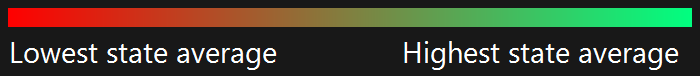

# Olist Power BI dashboard walkthrough

Open [dashboard.pbix](../powerbi/dashboard.pbix) in Power BI Desktop. The two pages show how a team could use the same Snowflake model to monitor merchandise sales and investigate delivery problems.

## Page 1 · Sales overview

The saved report opens the sales analysis with **2017** selected. The cards give scale before the charts show when sales peaked and which categories contributed most.

| Business question | What the report shows |
| --- | --- |
| How much did customers buy? | **R$6.16 million** in item sales, excluding freight, across **43,713 unique customers**. The average review score for orders purchased that year was **4.09 out of 5**. |
| When were sales strongest? | **November** led at **R$1.01 million**. October and December were the next two highest months, making **Q4** the strongest quarter at **R$2.42 million**, about **39%** of annual item sales. |
| Which categories led? | **Bed, bath and table** led at about **R$498,440**, followed by **watches and gifts** at **R$492,795** and **health and beauty** at **R$481,756**. The horizontal chart ranks the top 10 categories by item sales. |

A marketplace team could use the Q4 concentration to plan seller capacity and the category ranking to decide where to start. A single year gives a historical example. Repeated seasonality would require comparison across years, with comparable months and coverage.

## Page 2 · Reviews and delivery

The map gives a quick read on which customer states have lower average scores. Its continuous scale runs from red for the lowest state average to green for the highest. The adjacent table shows the average score, late delivery rate, and average days late. Select a state on the map to focus the table, then clear the selection to compare it with other states. This page uses the full snapshot by default, so its state figures have a different time scope from the 2017 sales example.

**Alagoas (AL) is a starting point for investigation.** It appears toward the low-score end of the map, at **3.75 out of 5**. It also has the highest displayed late delivery rate, **0.21**, or about **21%**. The source records give that figure scale: **85 of 397** orders with both delivery dates arrived after the estimated date, averaging **9.54 days late** among the late orders. By comparison, São Paulo shows **4.17** and a late rate of about **4.5%**.

The combination flags a state where delivery deserves investigation. The two state averages alone cannot establish whether lateness drove low scores. A fulfillment team could compare scores for late and on-time orders within Alagoas, with order counts beside each result. Breaking down the late orders by month and seller could show whether the issue is persistent or concentrated. If a subset accounts for much of the backlog, the team can investigate handoff delays or review promised delivery dates before changing operations across the whole state.

## How Snowflake supports the dashboard and further analysis

| Report metric | Warehouse path |
| --- | --- |
| Item sales by month and category | Sum `FACT_ORDER_ITEM.ITEM_PRICE_BRL` at the order-item grain. Join `DIM_DATE` on `PURCHASE_DATE_KEY` for purchase month and year, and `DIM_PRODUCT` on `PRODUCT_ID` for category. Freight and order-level payments are separate measures. |
| Unique customers | Filter `FACT_ORDER` to the purchase period, join `DIM_CUSTOMER` on `CUSTOMER_ID`, and count distinct `CUSTOMER_UNIQUE_ID`. |
| Average review score by state | Average `FACT_REVIEW.REVIEW_SCORE` at the review grain and use the customer state from `DIM_CUSTOMER`. |
| Late delivery rate and average days late | Start from one row per order in `FACT_ORDER`. Compare the actual delivery calendar date with the estimated date. The rate uses orders with both dates. The average length of delay uses late orders with valid delivery chronology. |

See the [fact build SQL](../sql/snowflake/build_facts.sql), [dimension build SQL](../sql/snowflake/build_dimensions.sql), and [Snowflake ERD](snowflake-erd.png).

For the Alagoas follow-up, Snowflake can classify each order as on time or late and aggregate reviews to one row per order before joining on `ORDER_ID`. That makes each reviewed order count once in the comparison. If the next question is about sellers, use distinct order–seller pairs from `FACT_ORDER_ITEM` so an order with several items from the same seller counts once for that seller. Orders with multiple sellers can appear in multiple seller groups.

The dashboard is the reporting component of the Python → PostgreSQL → Snowflake → Power BI project. It illustrates two ways to use the warehouse: answer recurring business questions with defined metrics, and use an unexpected pattern to frame a more focused investigation. The warehouse also supports analyses that the two pages leave open, such as seller performance, repeat purchasing, and freight by product category.
